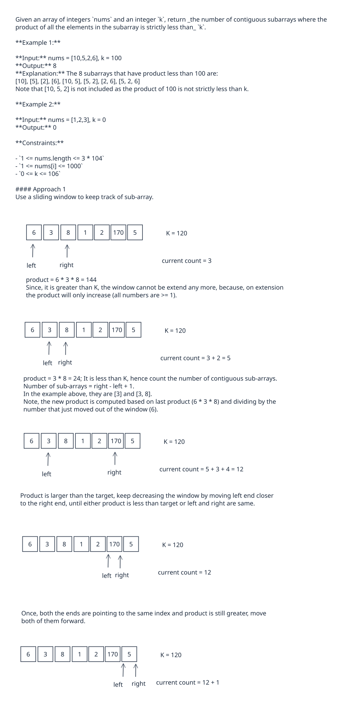

# Subarray product below threshold

Original whiteboard (anonymized export).

The board traces a sliding window, dividing out the leftmost factor when extending the window would exceed the threshold.

